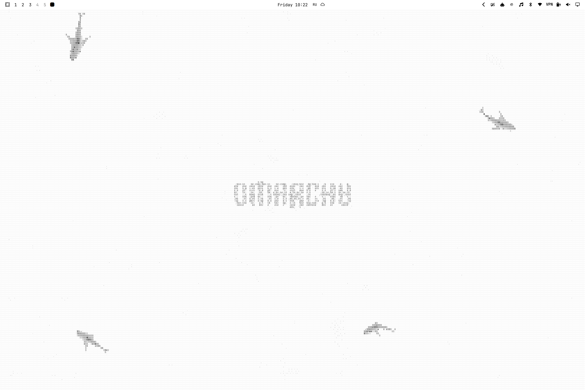

# ASCII Ocean Wallpaper

An animated ASCII ocean for the Omarchy White theme: eight species of sharks swim, schools of fish move and reappear from random edges, and an ASCII Omarchy logo sits in the center. The ocean is simulated continuously rather than played back as a looped video. When a shark comes within roughly two body lengths of the mouse cursor, it swims toward the cursor and circles it at twice its normal cruising speed.



[Watch the desktop recording](assets/desktop-demo.mp4) (15 seconds, no audio).

## Install

This is a small Linux/Wayland project tested on Omarchy with Hyprland 0.56.2. It uses Qt WebEngine and LayerShellQt, and currently targets the primary display and the White theme. Dependencies include Qt 6 Quick and WebEngine (including development headers), LayerShellQt, a C++ compiler, pkg-config, and systemd user services.

```sh
git clone https://github.com/evgyur/ascii-ocean-wallpaper.git
cd ascii-ocean-wallpaper
./install.sh
```

The installer copies the application into `~/.local/share/ascii-ocean-wallpaper`, adds a thumbnail to the White theme's user backgrounds, and enables a user service. It does not replace your existing backgrounds; it refuses to overwrite its own existing installation. To return to a different background, use Omarchy's background switcher (`Super + Ctrl + W`). The service removes the live layer when another background is selected. Selecting **ASCII Ocean Live** starts it again.

The thumbnail is a static fallback. Rendering the live simulation requires Qt WebEngine and consumes more CPU and memory than a static wallpaper. Display scaling, other themes, multiple monitors and other compositors have not been tested. The animation is capped at approximately 20 frames per second.

To remove the installation:

```sh
systemctl --user disable --now ascii-ocean-wallpaper.service
rm ~/.config/systemd/user/ascii-ocean-wallpaper.service
systemctl --user daemon-reload
rm -r ~/.local/share/ascii-ocean-wallpaper
rm ~/.config/omarchy/backgrounds/white/ascii-ocean-live.png
omarchy theme bg next
```

## Development

The modified TypeScript source is included in `src/`. Node.js is needed only to rebuild the bundled browser code, not to run the wallpaper.

```sh
npm ci
npm run typecheck
npm run build
```

The wallpaper uses a smaller grid and sharks, a monochrome light palette, a 20 fps rendering limit, and an ASCII logo overlay. The scene and fish behavior come from the original engine. The click-through wallpaper reads cursor coordinates locally from the Hyprland IPC socket, at most ten times per second; it does not log or transmit them.

## Credits and licenses

- Ocean engine and original ASCII sharks: **drewdi**, [stackedlol/ascii-sharks](https://github.com/stackedlol/ascii-sharks), MIT. Based on commit `a0074c16a106f0abc665fe9712ca445f8f98ad8e`; the full original notice is in [licenses/ascii-sharks-MIT.txt](licenses/ascii-sharks-MIT.txt).
- Omarchy logo: [Omarchy](https://github.com/omacom/omarchy), copyright David Heinemeier Hansson, MIT. Its notice is in [licenses/omarchy-MIT.txt](licenses/omarchy-MIT.txt). Omarchy’s name and logo belong to their respective owners; this project is independent.
- Wallpaper integration and adaptations are provided under the [MIT license](LICENSE).
